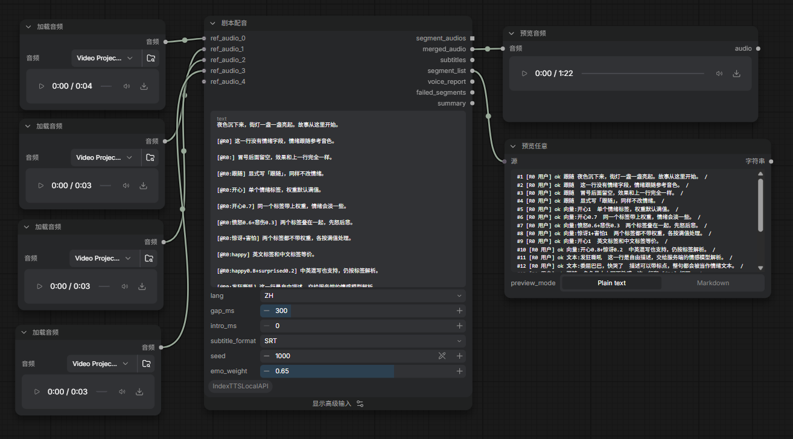

# Comfy-IndexTTSLocalAPI

English | [中文](#中文)

## Install

1. Copy the Comfy-IndexTTSLocalAPI folder into ComfyUI/custom_nodes/
2. Start your local IndexTTS WebUI (tested with index-tts v2.5.0-11-gd9e41aa, Gradio 5.45.0)
3. Restart ComfyUI

Requires a ComfyUI version with V3 nodes (comfy_api.latest).

Node titles, descriptions and tooltips follow ComfyUI's interface language (English / 中文).

## Usage

One node under Add Node → IndexTTSLocalAPI:

| Node | What it does | Outputs |
|---|---|---|
| Script Dubbing | One marked-up script → multi-role, multi-emotion dubbing + subtitles | segment_audios / merged_audio / subtitles / segment_list / voice_report / failed_segments / summary |

Write the script with segment markers:

~~~text
我打了三年工，今天终于把辞职信拍在桌上。

[@R1:发狂嘶吼] 你到底还是不懂我！

[@R0:心平气和] 是吗？今天天气真不错。
~~~

Marker syntax and emotion labels: [syntax-reference.md](syntax-reference.md) | [中文速查手册](语法速查手册.md)

Roles: the 1st audio wired into ref_audio = R0, the 2nd = R1, … Unconnected roles fall back to built-in voices (R0 female, R1 male ship with the plugin).

Each segment is one request. Segments are cached per seed under output/indextts-cache/<seed>/, so re-running with the same seed costs nothing.

Example script (covers every marker feature)

~~~text
夜色沉下来，街灯一盏一盏亮起。故事从这里开始。

[@R0] 这一行没有情绪字段，情绪跟随参考音色。

[@R0:] 冒号后面留空，效果和上一行完全一样。

[@R0:跟随] 显式写「跟随」，同样不改情绪。

[@R0:开心] 单个情绪标签，权重默认满值。

[@R0:开心0.7] 同一个标签带上权重，情绪会淡一些。

[@R0:愤怒0.6+悲伤0.3] 两个标签叠在一起，先怒后悲。

[@R0:惊讶+害怕] 两个标签都不带权重，各按满值处理。

[@R0:happy] 英文标签和中文标签等价。

[@R0:happy0.8+surprised0.2] 中英混写也支持，仍按标签解析。

[@R0:发狂嘶吼] 这一行是自由描述，交给服务端的情感模型解析。

[@R0:委屈巴巴，快哭了] 描述可以带标点，整句都会被当作情绪文本。

[@r1] 角色号大小写不敏感，这一行和 [@R1] 相同。

[@R01:平静0.8] 前导零会被忽略，R01 就是 R1。

[@R2]
段落可以跨行：从段标开始，
一直到下一个段标之前，都算同一段，
中间有多少换行都不会断开。

[@R9:惊讶] 角色号越界时按「n 对 10 取模」找内置角色。

[@R13:厌恶0.5] 十三对十取模等于三，所以实际用的是内置第 4 个角色。

这一行里出现了 [@R0] 但不在行首，所以它只是普通文字，会被念出来。
~~~

Full explanation and coverage table: [example-script.md](example-script.md)

## Example

Workflow file: [example_workflows/Comfy-IndexTTSLocalAPI.json](example_workflows/Comfy-IndexTTSLocalAPI.json)

Drag the JSON file onto the canvas, then point the four Load Audio nodes at your own reference voices.

## Sponsor

If this plugin saves you time, buy me a coffee ☕

| Alipay | WeChat Pay |
|---|---|
|  |  |

Special thanks to the **IndexTTS** team for the model and the local WebUI.

## 中文

### 安装

1. 把 Comfy-IndexTTSLocalAPI 文件夹放进 ComfyUI/custom_nodes/
2. 启动本地 IndexTTS WebUI（实测 index-tts v2.5.0-11-gd9e41aa，Gradio 5.45.0）
3. 重启 ComfyUI

需要支持 V3 节点的 ComfyUI 版本（comfy_api.latest）。

节点标题、描述与 tooltip 跟随 ComfyUI 的界面语言（中文 / English）。

### 使用

一个节点，在 Add Node → IndexTTSLocalAPI 下：

| 节点 | 作用 | 输出 |
|---|---|---|
| 剧本配音 | 一份带段标的剧本 → 多角色、多情绪配音 + 字幕 | segment_audios / merged_audio / subtitles / segment_list / voice_report / failed_segments / summary |

剧本用段标标出“谁说、什么情绪”：

~~~text
我打了三年工，今天终于把辞职信拍在桌上。

[@R1:发狂嘶吼] 你到底还是不懂我！

[@R0:心平气和] 是吗？今天天气真不错。
~~~

段标语法与情绪标签见 [语法速查手册](语法速查手册.md)。

角色：接进 ref_audio 的第 1 个音频 = R0，第 2 个 = R1……没接的角色用内置音色（R0 女声、R1 男声随包）。

每段一次请求；分段结果按 seed 缓存在 output/indextts-cache/<seed>/ 下，同 seed 重跑不花时间。

示例剧本（覆盖全部段标语法）

~~~text
夜色沉下来，街灯一盏一盏亮起。故事从这里开始。

[@R0] 这一行没有情绪字段，情绪跟随参考音色。

[@R0:] 冒号后面留空，效果和上一行完全一样。

[@R0:跟随] 显式写「跟随」，同样不改情绪。

[@R0:开心] 单个情绪标签，权重默认满值。

[@R0:开心0.7] 同一个标签带上权重，情绪会淡一些。

[@R0:愤怒0.6+悲伤0.3] 两个标签叠在一起，先怒后悲。

[@R0:惊讶+害怕] 两个标签都不带权重，各按满值处理。

[@R0:happy] 英文标签和中文标签等价。

[@R0:happy0.8+surprised0.2] 中英混写也支持，仍按标签解析。

[@R0:发狂嘶吼] 这一行是自由描述，交给服务端的情感模型解析。

[@R0:委屈巴巴，快哭了] 描述可以带标点，整句都会被当作情绪文本。

[@r1] 角色号大小写不敏感，这一行和 [@R1] 相同。

[@R01:平静0.8] 前导零会被忽略，R01 就是 R1。

[@R2]
段落可以跨行：从段标开始，
一直到下一个段标之前，都算同一段，
中间有多少换行都不会断开。

[@R9:惊讶] 角色号越界时按「n 对 10 取模」找内置角色。

[@R13:厌恶0.5] 十三对十取模等于三，所以实际用的是内置第 4 个角色。

这一行里出现了 [@R0] 但不在行首，所以它只是普通文字，会被念出来。
~~~

完整说明与覆盖对照：[example-script.md](example-script.md)

### 示例

工作流文件：[example_workflows/Comfy-IndexTTSLocalAPI.json](example_workflows/Comfy-IndexTTSLocalAPI.json)

把 JSON 拖进画布，再把四个「加载音频」换成你自己的参考音色即可。

### 支持这个项目

如果它帮你省了时间，欢迎请我喝杯咖啡 ☕

| 支付宝 | 微信支付 |
|---|---|
|  |  |

特别鸣谢 **IndexTTS** 团队提供模型与本地 WebUI。
